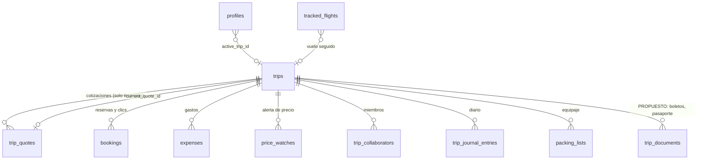
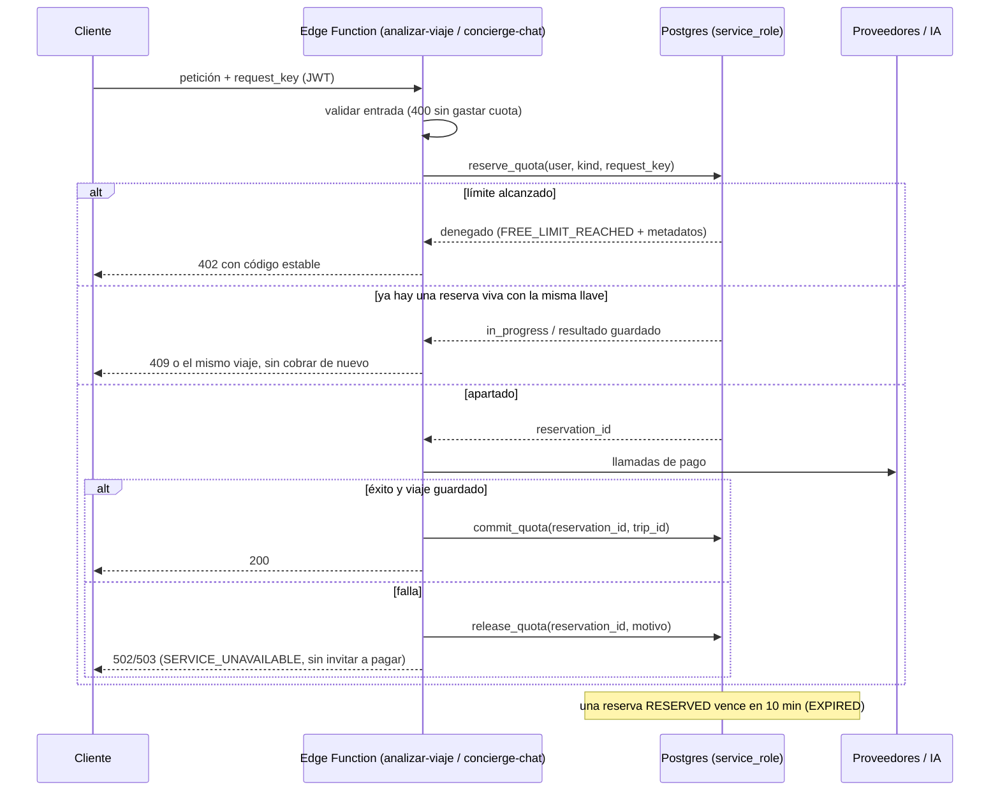

# IATOS: arquitectura objetivo

- **Fecha:** 2026-10-22.
- **Código revisado:** rama `claude/iatos-world-class`, commit `f4c4c72`, en solo lectura. `origin/main` = `ae6d5c8`.
  - Mientras se escribía este documento, el grupo de pagos fusionó su trabajo a la rama: el commit `d550aac` pasó a `f4c4c72`, que trae las reservas de cuota, los límites por plan y la prueba sin tarjeta, con los interruptores apagados.
  - Todo lo que aquí se afirma corresponde a `f4c4c72`.
- **Para quién es:**
  - los dos fundadores, que necesitan saber qué existe y qué falta;
  - Sebastián Mathus (NEXTIA), posible asesor técnico, que necesita poder verificar cada afirmación.
- **Documentos hermanos:**
  - [IATOS_PLAN_MEJORAS.md](./IATOS_PLAN_MEJORAS.md): el orden en que se hace todo esto.
  - [IATOS_TEST_MATRIX.md](./IATOS_TEST_MATRIX.md): qué prueba cada prueba automática.
  - [IATOS_HALLAZGOS_PRIORIZADOS.md](./IATOS_HALLAZGOS_PRIORIZADOS.md): el detalle de cada `IATOS-xxx`.
  - [IATOS_COSTOS_UNITARIOS.md](./IATOS_COSTOS_UNITARIOS.md) e [IATOS_PROPUESTA_PLANES_Y_PRUEBA.md](./IATOS_PROPUESTA_PLANES_Y_PRUEBA.md): costos y planes.

---

## 0. Cómo leer este documento

**Idea central: no hay reescritura ni una segunda arquitectura.** La arquitectura objetivo es la que ya existe:

- React en el navegador;
- Supabase (Auth, Postgres con RLS, Storage y 53 Edge Functions);
- pg_cron;
- los mismos proveedores.

Lo que cambia son **cinco reglas de diseño**, que se aplican sobre esa base:

1. **Un solo expediente por viaje.** Todo lo que se sabe de un viaje cuelga de `trips.id`.
2. **El servidor decide.** El origen de un precio, la cuota y el plan los decide el servidor, nunca el modelo de IA ni el navegador.
3. **El dinero falla cerrado.** Si no se puede verificar una cuota o un pago, se niega; no se regala.
4. **Cada dato dice de dónde salió y de cuándo es.** Esto se logra con los estados de procedencia de la sección 3.4.
5. **Operación vigilada.** Cada tarea automática deja rastro, y su falla se ve.

**Estado de cada elemento.** Hay uno solo por elemento:

| Estado | Significado | Cómo se comprobó |
|---|---|---|
| **EXISTE** | Corre hoy en producción. | Verificado en vivo el 2026-10-22, o presente en el código de `origin/main`, que es lo desplegado. |
| **EN RAMA** | Está construido en `claude/iatos-world-class` (commit `f4c4c72`), pero **no está desplegado**. | Código y pruebas en la rama. |
| **EN DESARROLLO** | Es trabajo del grupo de pagos, que lo sigue construyendo. Ya está fusionado en la rama (commits `6ffd183` a `4481448`, fusión `f4c4c72`), pero **apagado** (`app_flags` en `false`) o con partes que solo se siembran y no se aplican. **No está desplegado.** | Código leído. Sus pruebas Vitest y SQL **pasan hoy en local** (ver `IATOS_TEST_MATRIX.md`). |
| **PROPUESTO** | No hay código. Es diseño. | — |

**Qué está desplegado hoy (verificado en vivo el 2026-10-22):**

- **Base de datos.** De las migraciones nuevas, solo `supabase/migrations/20261022120000_security_p0_fixes.sql` está aplicada en producción. Las once `2026102213*.sql` (las siete de `130000` a `133000` y las cuatro de pagos, de `135000` a `135300`) **no** están aplicadas.
- **Funciones.** Las 53 funciones están desplegadas (sondeo OPTIONS). Todas corren la versión **anterior** a la rama, salvo `send-email`, que ya corre la versión corregida.
- **Datos.** 11 usuarios, todos con cortesía (`comped`). 0 pagando. Stripe está en modo de prueba. Quedan unas 216 búsquedas de SerpApi. El dominio de Resend no está verificado.

---

## 1. Resumen para los fundadores

- **Lo que ya está bien y se conserva:**
  - RLS en las 44 tablas;
  - funciones de servidor que validan quién llama;
  - una cadena de respaldo de IA probada;
  - tres tareas automáticas que corren.
- **Lo que la rama agrega** (construido y probado, falta desplegar):
  - un **historial de cotizaciones que no se puede editar**;
  - un **"viaje activo"** compartido;
  - **etiquetas honestas** de origen del precio;
  - una **capa de IA que valida** lo que dice Iato contra lo que de verdad encontró;
  - **tareas automáticas que no se pisan** entre sí y que avisan cuando fallan.
- **Lo que construyó el grupo de pagos** (ya en la rama, sin desplegar, con los interruptores apagados):
  - cuotas que se **apartan, se confirman y se devuelven** si algo falla;
  - **límites por plan** en una tabla;
  - la **prueba de 30 días sin tarjeta**.
- **Lo que falta diseñar y construir:**
  - una **bóveda de documentos** del viaje;
  - una **caché compartida de búsquedas** para bajar el costo de SerpApi;
  - el **registro del costo real** de cada llamada a IA;
  - el módulo de **México receptivo**, que reutiliza lo que ya existe.

---

## 2. Componentes actuales

### 2.1 Diagrama

```mermaid
flowchart TB
  subgraph Cliente["Navegador / PWA (React 18 + Vite + TS)"]
    UI["47 páginas, 48 rutas<br/>src/pages, src/components"]
    LIB["Lógica compartida en el cliente<br/>src/lib: provenance, activeTrip, fx, quote, planCopy, functionErrors"]
    SW["Service worker public/sw.js<br/>push (EXISTE) + offline (EN RAMA)"]
  end

  subgraph Supabase["Supabase (Lovable Cloud)"]
    AUTH["Auth (registro con correo)"]
    PG["Postgres: 44 tablas con RLS<br/>RPC SECURITY DEFINER solo service_role"]
    ST["Storage: recibos (privado),<br/>journal-photos y travel-moments (públicos, sin listado)"]
    EF["53 Edge Functions (Deno)<br/>+ supabase/functions/_shared"]
    CRON["pg_cron + pg_net + Vault<br/>3 tareas"]
  end

  subgraph IA["Modelos de IA"]
    CLAUDE["Claude Sonnet 5.5<br/>(análisis de viaje)"]
    GEM["Gemini directo → gemini-flash-latest<br/>→ Lovable AI Gateway (aiFetch)"]
    PPLX["Perplexity sonar / sonar-pro"]
  end

  subgraph Prov["Proveedores de datos y servicios"]
    SERP["SerpApi: Flights, Hotels, Maps, estado de vuelo"]
    TP["Travelpayouts / Aviasales<br/>(caché ≤48 h, afiliados)"]
    GMAPS["Google Maps / Places / Routes"]
    STRIPE["Stripe (modo prueba)"]
    RESEND["Resend (dominio sin verificar)"]
    OTROS["FX: frankfurter, open.er-api · Clima: open-meteo<br/>Pexels · PostHog · Sentry · Web Push VAPID"]
  end

  UI -- "supabase-js (llave anon + sesión)" --> AUTH
  UI -- "PostgREST bajo RLS" --> PG
  UI -- "functions.invoke (JWT del usuario)" --> EF
  UI --> ST
  CRON -- "HTTP con secreto de cron" --> EF
  EF -- "service_role" --> PG
  EF --> CLAUDE
  EF --> GEM
  EF --> PPLX
  EF --> SERP
  EF --> TP
  EF --> GMAPS
  EF --> RESEND
  STRIPE -- "webhook firmado" --> EF
  EF --> STRIPE
  UI --> OTROS
```

### 2.2 Descripción en texto

| Capa | Qué es | Estado | Dónde está |
|---|---|---|---|
| Cliente | SPA React 18 + Vite 5 + TypeScript + Tailwind. Habla con Supabase usando la llave pública `anon` y la sesión del usuario. | EXISTE | `src/` |
| Lógica compartida del cliente | Procedencia del precio, viaje activo, tipo de cambio, vigencia de la cotización, textos comerciales y lectura de errores 402. | EN RAMA | `src/lib/provenance.ts`, `src/lib/activeTrip.ts`, `src/lib/fx.ts`, `src/lib/quote.ts`, `src/lib/planCopy.ts`, `src/lib/functionErrors.ts` |
| Service worker | Push. | EXISTE | `public/sw.js` |
| | Abrir la app y leer los últimos 8 viajes sin red. | EN RAMA | `public/sw.js` |
| Auth | Registro abierto con correo. | EXISTE | Supabase Auth |
| Postgres | 44 tablas, todas con RLS (verificado en vivo). | EXISTE | `supabase/migrations/` (60 archivos en la rama) |
| | Funciones SQL de acceso: `is_pro`, `consume_free_quota`, `get_access_state`, `check_rate_limit`, `has_trip_access`. | EXISTE | ídem |
| Storage | `recibos` es privado. `journal-photos` y `travel-moments` son públicos, pero ya no se pueden listar (verificado en vivo: el listado anónimo devuelve `[]`). | EXISTE | `20261022120000_security_p0_fixes.sql` |
| Edge Functions | 53 funciones Deno más los módulos comunes de `_shared/`. Las 53 están desplegadas, con la versión anterior a la rama salvo `send-email`. | EXISTE (versión anterior) / EN RAMA (versión nueva) | `supabase/functions/` |
| Tareas programadas | `flight-watch-every-15-min`, `price-watch-twice-daily` y `health-check-daily`. | EXISTE | `docs/ops/programar-tareas.sql`, `docs/ops/LEEME.md` |
| IA | Claude para el análisis; Gemini con respaldo de Lovable para lo demás; Perplexity para investigación. | EXISTE (ver la sección 5 para lo nuevo) | `_shared/claude.ts`, `_shared/ai.ts` |
| Proveedores | SerpApi, Travelpayouts, Google Maps, Stripe, Resend, FX, clima, Pexels. | EXISTE | ver `IATOS_AUDITORIA_BASELINE.md`, sección 5 |

**Quién puede hacer qué:**

- **El cliente** solo lee y escribe sus propias filas (RLS).
- **Las Edge Functions** validan el JWT y usan `service_role` para lo que el cliente no debe tocar: cuotas, cotizaciones y suscripciones.
- **Las tareas de pg_cron** llaman a funciones que exigen un secreto guardado en Vault.
- **Stripe** solo entra por el webhook firmado.

---

## 3. El expediente vivo del viaje

### 3.1 Qué es

Es **un registro canónico por viaje** (`trips.id`) al que se ligan:

- el itinerario;
- las cotizaciones;
- las reservas;
- los gastos;
- las alertas;
- los documentos;
- el estado de procedencia de cada dato.

Cualquier pantalla, Iato o una tarea automática que hable "del viaje" usa ese mismo `id`. Hoy cada módulo elige su propio viaje (IATOS-028), y "Re-analizar" creaba un viaje nuevo y borraba el original (IATOS-008).

### 3.2 Piezas y estado

| Pieza | Qué guarda | Estado | Evidencia |
|---|---|---|---|
| `trips` | Fila canónica: destino, fechas, viajeros, itinerario (`itinerario_json`), vuelos, hospedaje, total en caché. | EXISTE | tabla en producción |
| `trips.current_quote_id`, `quote_basis`, `quote_needs_update` | La cotización vigente, con qué viajeros y fechas se calculó, y si el usuario los cambió después. Los mantiene un trigger (`trips_quote_basis_guard`), así que el cliente no puede escribirlos. | EN RAMA | `supabase/migrations/20261022133000_trip_quotes.sql:102-173`; `supabase/tests/security/trip_quotes.sql` Q1, Q8-Q10 (pasan en local) |
| `trip_quotes` | Una fila por cotización, con versión, moneda, total, desglose, renglones con estado, viajeros, noches, habitaciones, tipo de cambio (tasa, fuente, fecha, si fue de respaldo), fuentes y `valid_until`. | EN RAMA | misma migración, `:13-99` |
| Re-análisis en el mismo viaje | `analizar-viaje` recibe `trip_id`, verifica `has_trip_access` y actualiza la misma fila. El diario, el equipaje y los gastos sobreviven. | EN RAMA | commit `ac13186`; `supabase/functions/analizar-viaje/index.ts`; `src/lib/tripReanalysis.ts`; `src/test/tripReanalysis.test.tsx` (9 pruebas) |
| `bookings` | Clics de afiliado y reservas. | EXISTE | tabla |
| | La pantalla separa las "reservas confirmadas" de las "visitas a socios". | EN RAMA | `src/pages/Reservas.tsx`; `src/test/reservas.test.tsx` |
| | Estados Pagado y Pendiente de punta a punta. | PROPUESTO | IATOS-081. Ya existen como estados de renglón en `trip_quotes`, pero no hay un flujo que los use. |
| `expenses` | Gastos. | EXISTE | tabla |
| | Subtotal por moneda y total en MXN con la fuente y la fecha del tipo de cambio. Nunca convierte 1:1. | EN RAMA | `src/lib/fx.ts`; `src/test/fx.test.ts` |
| `tracked_flights` | Vuelos seguidos. | EXISTE (0 filas en vivo) | tabla |
| | Columnas de observabilidad, reclamo con `SKIP LOCKED` e intervalo según la cercanía del vuelo. | EN RAMA | `20261022132000_ops_flight_watch_reliability.sql` |
| `price_watches` | Una alerta por viaje. | EXISTE (0 filas en vivo) | tabla |
| | Guarda el monto y la moneda original del proveedor. | EN RAMA | `20261022132200_ops_price_watch_original_currency.sql` |
| `notifications.dedup_key` + `notify_once()` | Un aviso automático se guarda una sola vez. | EN RAMA | `20261022132100_ops_notifications_dedup.sql` |
| **Documentos del viaje** | Boletos, reservas en PDF y pasaporte. | **PROPUESTO** | No hay tabla ni bucket (IATOS-100). Diseño en 3.5. |
| Viaje activo | Ver 3.3. | EN RAMA (parcial) | ver 3.3 |
| Procedencia | Ver 3.4. | EN RAMA | ver 3.4 |

**Inmutabilidad de `trip_quotes` (lo que garantiza y lo que no):**

- **Un `UPDATE` siempre falla**, incluso con `service_role`, por el trigger `trip_quotes_no_update` (`:80-89`). Probado en local: `trip_quotes.sql` Q3.
- **Los usuarios no pueden insertar ni borrar**, por el `REVOKE` (`:98`). Probado en local: Q7.
- **No es inmutable en sentido estricto:**
  - borrar el viaje borra sus cotizaciones (`ON DELETE CASCADE`, `:15`; probado en local: Q11);
  - `service_role` conserva el permiso de `DELETE`.
  
  Si se necesita conservar la cotización aunque se borre el viaje (auditoría o disputas), habría que cambiar la cascada. Eso es **PROPUESTO** y requiere decisión del dueño, porque choca con el derecho de borrado (LFPDPPP).

### 3.3 Viaje activo

| Elemento | Estado | Evidencia |
|---|---|---|
| `profiles.active_trip_id`: FK a `trips` con `ON DELETE SET NULL`. Un trigger impide fijar un viaje ajeno y otro lo limpia si te quitan como colaborador. | EN RAMA | `supabase/migrations/20261022131000_active_trip_and_fixer_status.sql:6-59`. **No hay un archivo de prueba SQL** para estos triggers. El commit `89590c3` dice que se verificó en la réplica local; **NO VERIFICADO** por una prueba del repo. |
| `resolveActiveTrip()`: el orden es viaje mencionado (ciudad, país con alias como Japón → Tokio, o número de vuelo) > viaje elegido en el chat > `active_trip_id` > el único viaje en curso > el único próximo. Un empate devuelve "ambiguo" y se pregunta cuál. | EN RAMA | `supabase/functions/_shared/activeTrip.ts:139`, reexportado en `src/lib/activeTrip.ts`. Lo usan `concierge-chat/index.ts:267` y `src/pages/Concierge.tsx:136`. Pruebas: `src/test/iatoEvals.test.ts` E-01 a E-04 |
| Selector de viaje en el encabezado de Iato, que escribe `active_trip_id`. | EN RAMA | `src/components/concierge/TripContextSelector.tsx` |
| **Que Dashboard, Cercanos, Gastos y Fixer usen el mismo viaje activo** | **PROPUESTO** | Hoy solo el concierge llama a `resolveActiveTrip` (búsqueda en `src/`). El resto de IATOS-028 sigue abierto. |

### 3.4 Estados de procedencia del dato

Hay una sola regla para todas las pantallas (`src/lib/provenance.ts:1-28`): **un precio solo se presenta como "consultado en vivo" si vino de un proveedor en vivo y se consultó hace menos de 24 h** (`LIVE_TTL_HOURS = 24`).

| Estado | Cuándo se usa | Ejemplo de texto al usuario |
|---|---|---|
| `CONFIRMADO` | Lo confirmó el servidor o el proveedor (por ejemplo, un pago o una reserva con folio). | — |
| `CONSULTADO_EN_VIVO` | Google Flights o Hotels vía SerpApi, consultado hace menos de 24 h. | "Consultado en vivo" |
| `ESTIMADO` | Estimado por IA, por Perplexity, con fechas aproximadas o con una etiqueta desconocida. | "Estimado por IA" |
| `PENDIENTE_DE_VERIFICACION` | Se editó con IA o cambiaron las fechas o los viajeros y no se volvió a consultar. | — |
| `NO_DISPONIBLE` | El proveedor no respondió o no hubo resultados. | "Búsqueda en vivo no disponible" |
| `OBSOLETO` | Precio en vivo de hace más de 24 h, o sin fecha de consulta. | "Precio de hace X; verifica antes de reservar" |

| Elemento | Estado | Evidencia |
|---|---|---|
| `provenanceOf()` y `PriceSourceBadge` en el cliente | EN RAMA | `src/lib/provenance.ts:107`; `src/components/PriceSourceBadge.tsx`; `src/test/provenance.test.ts` (16), `src/test/priceSourceBadge.test.tsx` (4) |
| En el servidor, `enforceSources` decide `estado_dato` y `consultado_at` comparando contra lo que se consultó en esa misma petición. El modelo ya no puede marcar algo como "en vivo". | EN RAMA | `supabase/functions/analizar-viaje/sources.ts`; `src/test/tripSources.test.ts` (10), `src/test/logisticsProvenance.test.ts` (4), `src/test/editReconcile.test.ts` (5) |
| La caché de Travelpayouts nunca dice "en vivo". Muestra "Precio de referencia (caché ≤48 h)". | EN RAMA | `src/test/provenance.test.ts` |
| **Unificar los vocabularios** | **PROPUESTO** | Hoy conviven tres conjuntos de estados: el de `src/lib/provenance.ts` (6 estados); el de las tarjetas de Iato en `supabase/functions/concierge-chat/cards.ts:20` (`CONSULTADO_EN_VIVO`, `NO_VERIFICADO`, `SOLICITUD_HUMANA`); y el de los renglones de `trip_quotes` (`COTIZADO`, `ESTIMADO`, `PAGADO`, `PENDIENTE`, `OPCIONAL`, `EXCLUIDO`). Propuesta: un solo módulo de tipos con una tabla de equivalencias. Son tres ejes distintos (procedencia, solicitud humana y estado comercial del renglón) y no conviene mezclarlos sin documentarlos. |

### 3.5 Propuesta: documentos del viaje (PROPUESTO)

- **Tabla `trip_documents`** con las columnas `id`, `trip_id` (FK a `trips`), `user_id`, `kind` (boleto, reserva, pasaporte, seguro u otro), `storage_path`, `mime`, `bytes`, `extracted jsonb` (lo que leyó `parse-trip-file`, siempre marcado como "Según tu archivo (sin verificar)", estado que ya existe en `provenance.ts`) y `created_at`.
- **Bucket privado `trip-documents`**, con lectura por *signed URL* de vida corta. No debe repetirse el patrón de bucket público de `journal-photos` (IATOS-003, mejora pendiente).
- **El tipo y el tamaño se validan en el servidor** (IATOS-054).
- **Los datos de pasaporte no van a la IA**, salvo que el usuario lo pida y lo consienta.
- **Modo offline:** el service worker de la rama ya guarda los últimos 8 viajes. Los documentos sin red serían un paso posterior, cifrados en el dispositivo; eso necesita su propio diseño de seguridad.

---

## 4. Modelo de cuotas y derechos (*entitlements*)

### 4.1 Qué existe hoy en producción

| Elemento | Estado | Comportamiento |
|---|---|---|
| `is_pro(user)` | EXISTE | `active`, `trialing` o `comped`. Un `trialing` sin `current_period_end` cuenta como PRO para siempre (riesgo 2 de la propuesta de planes). |
| `consume_free_quota(user, kind)` | EXISTE | Solo conoce `concierge` (3 al mes) y `trip_analysis` (1 de por vida). PRO pasa siempre. En producción **no es atómica** (IATOS-092) y **se descuenta antes de validar** (IATOS-047). |
| `get_access_state(user)` | EXISTE | Lo que lee el cliente (`useSubscription`). |
| `check_rate_limit` | EXISTE | Límites por minuto y por hora. Falla abierto, y la IP sale de `X-Forwarded-For`, que el cliente puede falsificar (IATOS-048; control 6 de la propuesta). |

### 4.2 Lo que agrega la rama (EN RAMA)

| Elemento | Evidencia |
|---|---|
| `consume_free_quota` atómica (`UPDATE ... WHERE used < limit RETURNING`), misma firma. | `20261022130000_pay_stripe_sync_and_atomic_quota.sql:45-93`; `supabase/tests/payments/run.sh` (concurrencia: 1 permitida y 1 negada; **pasa en local**) |
| Validar antes de consumir; `trip_analysis` falla cerrado (503, no el aviso de pago); `logistics-plan` consume la misma cuota. | commit `cace072`; `supabase/functions/_shared/quota.ts`; `src/test/quota.test.ts` (10) |
| Sincronía de Stripe ordenada por fecha del evento; la cortesía no pisa un pago; la cortesía exige correo confirmado. | misma migración `:102-277`; `supabase/tests/payments/payments.sql` S1-S8 y C1-C3 (**pasan en local**) |

### 4.3 Lo que construyó el grupo de pagos (EN DESARROLLO: en la rama, apagado)

Son los commits `6ffd183` a `4481448`, fusionados a esta rama en `f4c4c72` el 2026-10-22 hacia las 03:00 UTC. **Nada de esto está en producción.** Por omisión el comportamiento es el de hoy: GRATIS con 3 mensajes al mes y 1 análisis de una sola vez, PRO sin límites y sin prueba sin tarjeta. Los cambios de comportamiento dependen de interruptores que el dueño debe encender.

| Pieza | Qué hace | Archivo |
|---|---|---|
| `quota_reservations` | Una fila por intento: `(user_id, kind, request_key)` único y `status` ∈ RESERVED, COMMITTED, RELEASED o EXPIRED. Una reserva sin confirmar caduca a los 10 min. `counted=false` para PRO. Tipos: `trip_analysis` y `concierge`. | `supabase/migrations/20261022135000_pay_quota_reservations.sql:12-35` |
| `reserve_quota` / `commit_quota` / `release_quota` | Apartar es atómico e idempotente por `request_key`. Se confirma solo cuando el viaje quedó guardado. Se libera si algo falló. Solo `service_role` las ejecuta. | misma migración `:126-286` |
| `plan_limits` | Límites en una tabla: `(plan, kind, period, limit_value, daily_limit, soft)`. Planes `free`, `pro` y `trial`. Periodos `month`, `once`, `day`, `trial` y `active`. `NULL` = ilimitado. Se cambian con un `UPDATE`, sin desplegar. | `20261022135100_pay_plan_limits.sql:8-27`; valores recomendados en `20261022135300_pay_plan_limits_recommended.sql:50-64` |
| `app_flags` | Interruptores que solo lee el servidor. Ambos se siembran en `false`: `pro_limits_enforced` (aplicar los límites de PRO) y `trial_no_card_enabled` (DEC-02). | `20261022135100_pay_plan_limits.sql:29-42` |
| `trial_grants` + `apply_no_card_trial()` | Prueba de 30 días sin tarjeta al confirmar el correo, solo si el interruptor está encendido. Una por correo normalizado: se guarda el SHA-256 y se conserva aunque se borre la cuenta. | `20261022135200_pay_trial_no_card.sql` |
| `is_pro` corregido; `effective_plan`; `plan_limit` | Un `trialing` sin fecha de fin ya no es PRO para siempre. | `20261022135300_pay_plan_limits_recommended.sql:11-131` |
| Contrato de errores estable | `FREE_LIMIT_REACHED` (402, solo metadatos seguros), `SERVICE_UNAVAILABLE` (503, sin invitar a pagar), `ANALYSIS_IN_PROGRESS` (409) y `UNAUTHENTICATED` (401). | `supabase/functions/_shared/quota.ts`; `src/test/quota.test.ts` (10) |
| Reservas en las funciones | `analizar-viaje` y `logistics-plan` reservan, confirman solo si el resultado cumple el contrato mínimo (`analysisMeetsContract` y `logisticsMeetsContract`) y quedó guardado, y liberan ante *timeout*, error, caída de la IA, datos insuficientes, resultado parcial o falla al guardar. `concierge-chat` reserva un mensaje y lo libera si pregunta "¿cuál viaje?" o si el modelo falla (`concierge-chat/index.ts:235-510`). | `supabase/functions/_shared/reservation.ts`, `_shared/entitlements.ts:45-70`; `src/test/reservation.test.ts` (17) |
| Diálogo de límite gratuito y llave por intento | El diálogo reemplaza "hubo un tropiezo" en Iato, PlanTrip, multidestino y EditTrip; la llave por intento se guarda en `sessionStorage`. | commits `9c1a09b`, `ce1c508`, `ced3666`; `src/lib/functionErrors.ts`; `src/test/freeLimitDialog.test.tsx` (3), `src/test/functionErrors.test.ts` (13), `src/test/requestKey.test.ts` (5) |
| `stripe-checkout` durante la prueba sin tarjeta | No da otra prueba de Stripe; el primer cobro espera al fin de la prueba de la app (o al mínimo de 48 h de Stripe). | `supabase/functions/stripe-checkout/logic.ts`; `src/test/stripeCheckout.test.ts` (17, de las cuales 5 son de DEC-02) |
| Diagnóstico de cuotas perdidas | Consulta de solo lectura y una propuesta de reparación auditable. **No se ha corrido en producción.** | `docs/ops/diagnostico-cuotas.sql`, `docs/ops/reparacion-cuotas-PROPUESTA.sql` |

**Límites que esas migraciones solo siembran y que todavía no se aplican** (lo dicen sus propias notas: "aún no se aplica"): `price_watches`, `tracked_flights` y `live_searches`. Hoy solo `concierge` y `trip_analysis` pasan por `reserve_quota`.

**Riesgo de orden de despliegue:** `reserveQuota` falla cerrado (`_shared/entitlements.ts:48-55`). Si las funciones nuevas se despliegan **antes** de las migraciones `135000` a `135300`, la RPC `reserve_quota` no existe: **todos** los mensajes de Iato y todos los análisis se niegan, también para PRO. Por eso el plan exige migraciones antes que funciones (`IATOS_PLAN_MEJORAS.md`, sección 1).

### 4.4 Flujo objetivo de una operación con cuota

### 4.5 Lo que falta diseñar (PROPUESTO)

- **Aplicar los topes** de `price_watches`, `tracked_flights` y `live_searches` en `price-watch`, `track-flight` y las funciones de búsqueda. Hoy `track-flight` tiene un tope fijo de 10 para todos (`supabase/functions/track-flight/rules.ts:4`).
- **`ai_usage_log`**: una fila por llamada a Claude, Gemini, Perplexity o SerpApi, con su modelo, sus tokens y un costo estimado. Hoy **ninguna función guarda `usage`** (`IATOS_COSTOS_UNITARIOS.md`, sección 7, punto 7).
- **Corregir `clientIp`** para que no confíe en `X-Forwarded-For` (`supabase/functions/_shared/rate-limit.ts`).
- **Contadores visibles** ("te quedan X de Y") en la interfaz.

---

## 5. Capa de IA

| Elemento | Estado | Evidencia |
|---|---|---|
| **Claude Sonnet 5.5** (`claude-sonnet-5-5`) para el análisis de viaje | EXISTE en `analizar-viaje` (auditoría) | `IATOS_AUDITORIA_BASELINE.md`, sección 5 |
| Llamada a Claude compartida (`CURRENT_CLAUDE_MODEL`). Prueba primero `ANTHROPIC_MODEL` si existe; no manda `temperature` ni fuerza `tool_choice`; un rechazo se trata como "sin resultado" y cae a Gemini. La usan `analizar-viaje`, `buscar-promociones` y `nightlife-discover`. | EN RAMA | `supabase/functions/_shared/claude.ts:14-19`; `src/test/claudeCall.test.ts` (4). En producción, `buscar-promociones` y `nightlife-discover` todavía llaman a un modelo retirado (IATOS-031). |
| **Gemini vía `aiFetch`**: Gemini directo con su llave → `gemini-flash-latest` → Lovable AI Gateway. Las imágenes siempre van a Lovable. | EXISTE | `supabase/functions/_shared/ai.ts`; `src/test/aiFetch.test.ts` (7) |
| Al caer a Lovable, el alias `gemini-flash-latest` se traduce a `google/gemini-2.5-flash`, porque no está verificado que el gateway acepte el alias. | EN RAMA | `_shared/ai.ts:20-32` |
| Iato usa `google/gemini-flash-latest`. | EN RAMA | `supabase/functions/concierge-chat/index.ts:407`. **Riesgo de costo:** Google no publica a qué modelo apunta el alias, y el precio de 3.8 Flash se duplica el 2027-01-01 (`IATOS_COSTOS_UNITARIOS.md`, sección 1.1). Fijar el modelo explícitamente queda como **PROPUESTO**. |
| **Herramientas de Iato** (5): `search_flights` → `flights-search`, `search_hotels` → `hotels-search`, `search_attractions` → `tripadvisor-search`, `search_nearby` → `places-nearby` y `check_flight_status` → `flight-status`. | EXISTE (con defectos) / EN RAMA (corregidas) | `concierge-chat/index.ts:41-129` |
| Resultados de herramienta recortados por estructura (`slimToolResult`), que siguen siendo JSON válido. | EN RAMA | `concierge-chat/tools.ts:61`; `src/test/conciergeTools.test.ts`; `iatoEvals` E-06 |
| Herramientas en paralelo con 15 s de límite cada una; máximo 4 vueltas al modelo; la última obliga a responder sin herramientas. | EN RAMA | `concierge-chat/tools.ts:95-139`, `concierge-chat/loop.ts`; `iatoEvals` B-15 |
| **Validación de tarjetas** (`validateCards`): descarta las mal formadas o de tipo desconocido; solo acepta `https`; muestra un precio solo si coincide (±1%) con un resultado de herramienta de ese turno y le pone la fuente; jet y equipaje nunca llevan precio; máximo 8 tarjetas. Si una búsqueda no estuvo disponible y el texto no lo dice, se antepone una frase honesta. | EN RAMA | `concierge-chat/cards.ts:216-308`; `src/test/conciergeCards.test.tsx` (17); `iatoEvals` E-05 a E-11 |
| Los resultados `ai-fallback`, vacíos o con error le llegan al modelo como `{disponible:false, motivo}`. | EN RAMA | `cards.ts:85-127`; `src/test/liveSearchFallback.test.ts` (4) |
| **Protección contra *prompt injection***: el mensaje de sistema lleva solo nuestras reglas; el perfil, los viajes, la memoria y el texto de PDF van en un mensaje de contexto aparte, delimitado y neutralizado; el historial del cliente queda en solo `user`/`assistant`, 10 mensajes de hasta 4,000 caracteres. | EN RAMA | `concierge-chat/guard.ts`, `concierge-chat/prompt.ts`; `iatoEvals` E-15 y E-16 |
| Fecha "de hoy" con la zona horaria IANA del cliente, validada. | EN RAMA | `guard.ts` (`resolveToday`); `iatoEvals` E-20 |
| Memoria visible y borrable por el usuario. | EN RAMA | `src/components/concierge/IatoMemoryPanel.tsx`; `iatoEvals` E-19 |
| **Suite de evaluación** | EN RAMA (parte determinista) | `src/test/iatoEvals.test.ts`: 30 pruebas con modelo y proveedores simulados. Lo que depende de cómo redacta un modelo real (E-12 texto, E-15 obediencia, E-17, E-18, E-19 recuerdo) **no está automatizado**; ver `IATOS_TEST_MATRIX.md`, sección 5. |
| Prueba que impide volver a usar un modelo retirado | EN RAMA | `src/test/retiredModels.test.ts` |
| **Evaluación con modelo real** en un ambiente de prueba, con presupuesto fijo | PROPUESTO | — |
| **Fijar modelos y registrar el que respondió** (`ai_usage_log`) | PROPUESTO | ver 4.5 |

---

## 6. Operación

| Elemento | Estado | Evidencia |
|---|---|---|
| 3 tareas de pg_cron que llaman a funciones con el secreto de Vault. | EXISTE (verificado en vivo) | `docs/ops/programar-tareas.sql`; `docs/ops/LEEME.md` |
| Autenticación de cron que falla cerrado (`isAuthorizedCron`, `verify_cron_secret`). En vivo, las funciones de cron responden 401 sin el secreto. | EXISTE | `IATOS_MATRIZ_FUNCIONAL.md`, módulo 9 |
| La lógica de esa autenticación se separó para poder probarla, con comparación en tiempo constante. `verify_cron_secret` ahora también vive en una migración. | EN RAMA | `supabase/functions/_shared/cron-auth-core.ts`; `src/test/cronAuth.test.ts` (9); `20261022132300_ops_health_check_jobs_and_email.sql:84-99` |
| **Reclamo con `SKIP LOCKED`** en el seguimiento de vuelos. `claim_tracked_flights` marca `last_attempt_at` en la misma sentencia, así que dos corridas simultáneas reciben vuelos distintos; también retira los vuelos sin fecha, los de fecha pasada y los que aterrizaron hace más de 3 h. | EN RAMA | `20261022132000_ops_flight_watch_reliability.sql:66-117`; `supabase/tests/ops/concurrent_claim.sh` (**pasa en local**: A reclamó AM1-AM3 y B, con A abierta, AM4-AM6); `flight_watch_claim.sql` T1-T9 |
| Estado honesto de cada revisión de vuelo: `ok`, `no_data`, `date_mismatch`, `quota` o `provider_error`. Solo `ok` cuenta como revisión exitosa. | EN RAMA | `supabase/functions/_shared/flight-serpapi.ts`; `src/test/flightWatchRules.test.ts` (19), `src/test/flightWatchRunner.test.ts` (8) |
| `price-watch-cron` deduplica avisos con `notify_once` y compara en la moneda del proveedor. **No** usa un reclamo con `SKIP LOCKED`: lee un lote de 40 (`price-watch-cron/index.ts:16, 39`). | EN RAMA (dedup) / PROPUESTO (reclamo) | dos corridas encimadas podrían gastar búsquedas dos veces (IATOS-066, parte de alertas de precio) |
| **health-check con `cron_health()`**: revisa `cron.job`, `cron.job_run_details` y `net._http_response`. Falla si una tarea no corrió en 2 veces su periodo, si su última corrida falló, si falta o si todas sus llamadas HTTP fallaron. Manda correo solo cuando cambia lo que falla (o un recordatorio semanal) y guarda `email_status`. | EN RAMA | `20261022132300_ops_health_check_jobs_and_email.sql:17-78`; `supabase/functions/health-check/index.ts:42`; `src/test/healthAlerts.test.ts` (22); `supabase/tests/ops/cron_health.sql` C1 (**pasa en local**, con tablas que imitan pg_cron) |
| **Redacción de secretos**: `redactSecrets` quita `api_key=` y `token=` de las URLs, los *bearer* y los prefijos de llaves conocidos antes de guardar o enviar por correo. | EN RAMA | `supabase/functions/_shared/redact.ts`; `healthAlerts.test.ts` ("secret redaction") |
| Push web: VAPID se configura al primer envío (ya no truena al arrancar) y lleva TTL. | EN RAMA | `supabase/functions/_shared/push-core.ts`; `src/test/pushCore.test.ts` (5) |
| **Registro de migraciones**: producción tiene 35 registradas contra 60 archivos en la rama. | EXISTE el defecto | IATOS-072, BLOQUEADO (requiere una operación en producción) |
| CI que corra las suites SQL | PROPUESTO | Hoy se corren a mano (`supabase/tests/*/run.sh`) |
| El aviso de SerpApi salta por debajo de 200 búsquedas | EXISTE | `supabase/functions/health-check/checks.ts`. Propuesta: por debajo del 20% del plan (`IATOS_PROPUESTA_PLANES_Y_PRUEBA.md`, riesgo 1). |

---

## 7. Modelo de seguridad

| Control | Estado | Evidencia |
|---|---|---|
| RLS activo en las 44 tablas | EXISTE (verificado en vivo) | — |
| Colaborador falso, amistad falsa, listado de buckets, cambio de dueño y escritura directa de `tracked_flights` cerrados | EXISTE (verificado en vivo) | `20261022120000_security_p0_fixes.sql`. En vivo: las políticas se eliminaron, los privilegios se revocaron, el listado anónimo devuelve `[]` y una URL pública de avatar sigue respondiendo 200. Prueba local: `supabase/tests/security/rls_attacks.sql` A1-A5 bloqueados y L1-L7 pasan (**re-ejecutado hoy en local**). |
| `send-email` solo manda invitaciones verificadas en el servidor | EXISTE (verificado en vivo) | `supabase/functions/send-email/index.ts`. En vivo: `to`/`html` libres → 400; viaje ajeno → 403; sin sesión → 401; el bundle en vivo manda solo `trip_id`/`friend_id`. **No hay prueba automática del *handler*.** |
| RPC solo para `service_role` (`REVOKE ... FROM PUBLIC, anon, authenticated`) | EXISTE: `consume_free_quota`, `is_pro`, `check_rate_limit`, `purge_account_data` (en vivo). EN RAMA: `apply_stripe_subscription`, `stripe_sub_is_live`, `has_comp_grant`, `apply_comp_grants_now`, `claim_tracked_flights`, `tracked_flight_gap`, `notify_once`, `cron_health`, `verify_cron_secret`. EN DESARROLLO: `reserve_quota`, `commit_quota`, `release_quota`, `app_flag`, `plan_limit`. | `payments.sql` Q5 y `flight_watch_claim.sql` T1-T2 (**pasan en local**) |
| Cuotas en el servidor | EXISTE (no atómica en producción) / EN RAMA (atómica) / EN DESARROLLO (reservas y planes) | sección 4 |
| Webhook de Stripe con firma verificada | EXISTE | auditoría, sección 5 |
| El webhook responde 500 ante errores de la base para que Stripe reintente; usa el estado vivo de Stripe; maneja `invoice.paid`. | EN RAMA | `supabase/functions/stripe-webhook/handler.ts`; `src/test/stripeWebhook.test.ts` (12) |
| `stripe-checkout` no abre una segunda suscripción; da la prueba de Stripe una sola vez; las URL de regreso se limitan a dominios propios. | EN RAMA | `supabase/functions/stripe-checkout/logic.ts`; `src/test/stripeCheckout.test.ts` (17) |
| `trip_quotes` y `quote_basis` solo los escribe el servidor | EN RAMA | `trip_quotes.sql` Q4-Q10 |
| Rastreadores (PostHog, Travelpayouts) solo después del consentimiento | EN RAMA | `src/lib/consent.ts`; `src/test/cookieConsent.test.tsx` |
| **Abierto:** el usuario puede editar cualquier columna de su perfil (IATOS-052); los amigos ven el perfil completo (053); los uploads no se validan en el servidor (054); `journal-photos` sigue siendo un bucket público (mejora de 003); IP falsificable (048); HTML sin escapar en `enviar-email-fixer` (parte de 051). | PROPUESTO | `IATOS_HALLAZGOS_PRIORIZADOS.md` |

---

## 8. Control de costos

SerpApi es la restricción que manda: el análisis, el chat, las alertas, el seguimiento de vuelos y `serpapi-quote` gastan de la misma bolsa (`IATOS_COSTOS_UNITARIOS.md`, sección 3).

| Control | Estado | Evidencia |
|---|---|---|
| Límites por minuto y por hora en cada función | EXISTE | `supabase/functions/_shared/rate-limit.ts` |
| Tope de 10 vuelos activos por usuario; fecha obligatoria dentro de ~11 meses | EN RAMA | `track-flight/rules.ts:4`; `src/test/trackFlightRules.test.ts` (6) |
| Intervalo según la cercanía del vuelo (6 h, 3 h, 15 min o 1 h), con espera extra tras fallas; máximo de revisiones por corrida (`FLIGHT_WATCH_MAX_CHECKS`, 50 por omisión, tope de 200); 1 búsqueda por vuelo y fecha en cada corrida | EN RAMA | `20261022132000_ops_flight_watch_reliability.sql:44-64`; `flight_watch_claim.sql` T9; `flightWatchRunner.test.ts` |
| La corrida se detiene si SerpApi dice que se acabó la cuota | EN RAMA | `flightWatchRunner.test.ts` |
| Hasta 40 alertas de precio por corrida, 2 veces al día | EXISTE | `price-watch-cron/index.ts:16` |
| Las búsquedas fallidas ya no inventan resultados (con botón de compra) | EN RAMA | `src/test/liveSearchFallback.test.ts` |
| **Caché compartida de SerpApi** (`serp_cache`): vuelos 30 a 60 min, hoteles 6 h, Maps 7 días, estado de vuelo 15 min | **PROPUESTO** | No hay código: ninguna coincidencia de `serp_cache` en `supabase/`. Ahorro estimado del 20 al 40% [SUPUESTO] (`IATOS_PROPUESTA_PLANES_Y_PRUEBA.md`, sección 5.4) |
| Caché de 24 h en `serpapi-quote` | PROPUESTO | Hoy gasta 2 búsquedas en cada vista de un viaje manual, también en GRATIS |
| Nueva frecuencia de seguimiento (~17 búsquedas por vuelo en PRO y ~8 en GRATIS) con `no_cache` solo en la ventana final | PROPUESTO | propuesta, sección 5.3 |
| SerpApi como máximo cada 72 h por alerta | PROPUESTO | propuesta, sección 8.2 |
| Topes por plan y bolsa de búsquedas en vivo | EN DESARROLLO (solo sembrados) / PROPUESTO (aplicación) | sección 4.3 |
| Perplexity opcional en el análisis; resumen del viaje en lugar del JSON completo en Iato; caché de prompt en Claude | PROPUESTO | propuesta, sección 5.4 |

---

## 9. Experiencia México receptivo (visión del dueño): módulo PROPUESTO

**Todo en esta sección es PROPUESTO.** No hay código específico. La regla es **reutilizar los módulos de destino y de proveedores que ya existen**, sin crear otra app ni otra base.

**Qué es:** atender a viajeros que **vienen a México**. Hoy el producto está pensado para mexicanos que viajan al extranjero.

**Qué se reutiliza tal cual:**

| Módulo existente | Estado | Uso en México receptivo |
|---|---|---|
| `trips` + expediente vivo (sección 3) | EXISTE / EN RAMA | El viaje del visitante es un viaje como cualquier otro. |
| `hotels-search`, `flights-search`, `tripadvisor-search`, `places-nearby`, `nearby-places`, `place-details`, `get-routes`, `geocode` | EXISTE | Inventario y lugares en ciudades mexicanas. |
| `src/lib/countriesCities.ts` (México con 16 ciudades), `src/lib/cultureProfiles.ts` (perfil "mexico"), `src/lib/emergencyNumbers.ts` (México: 911) | EXISTE / EN RAMA (SOS) | Datos de destino. |
| `destination_daily_costs`, `historical_flight_prices` (lectura anónima de referencia) | EXISTE | Costos de referencia. **Cobertura de México NO VERIFICADA.** |
| Concierge Iato con sus herramientas, las validaciones y la procedencia | EN RAMA | Mismo concierge. |
| `analizar-viaje` / `logistics-plan` | EXISTE / EN RAMA | Plan de un destino o multidestino dentro de México. |
| Tipo de cambio (`_shared/fx.ts`, `src/lib/fx.ts`) | EN RAMA | Mostrar USD, EUR o CAD frente a MXN con fuente y fecha. |

**Qué faltaría (todo PROPUESTO):**

1. **Idioma.** La interfaz y los textos están en español; no hay una capa de i18n en `src/`. Hace falta al menos inglés.
2. **Contenido local verificable**: proveedores locales con enlace de afiliado confirmado (hoy la atribución `tp.media` está BLOQUEADA, IATOS-077) y fuentes citables para avisos de seguridad (IATOS-091).
3. **Cobro a extranjeros**: tarjeta internacional (+0.5% en Stripe), moneda de cobro e IVA. Requiere decisión del dueño y está ligado a IATOS-011.
4. **Un perfil de "origen del viajero"** en `trips` o `profiles` para ajustar vuelos de llegada, visa y moneda. No es un esquema nuevo: es una columna.

**Dependencias:** salir a producción con la rama, Stripe en modo real y un plan de SerpApi suficiente. No debe empezar antes de cerrar las fases A y B del plan.

---

## 10. Riesgos de arquitectura abiertos

| # | Riesgo | Estado | Dónde se trata |
|---|---|---|---|
| 1 | **Los textos comerciales de la rama** (`src/lib/planCopy.ts`, commit `d550aac`) prometen una prueba de 30 días sin tarjeta y los límites de PRO. La prueba ya está en la rama, pero **apagada** (`trial_no_card_enabled=false`), y los límites de PRO también (`pro_limits_enforced=false`). Con el interruptor apagado, `stripe-checkout` sigue dando la prueba de Stripe, que pide tarjeta (`stripe-checkout/index.ts:84`; prueba "con el interruptor apagado…" en `stripeCheckout.test.ts`). Publicar el frontend sin encender la prueba reabre IATOS-012 al revés: se promete algo que el sistema no hace. | EN RAMA | `IATOS_PLAN_MEJORAS.md`, sección 1, compuerta G-1 |
| 2 | **Deriva de migraciones** entre el repo y producción. | BLOQUEADO | IATOS-072 |
| 3 | **Ninguna función tiene una prueba de punta a punta del *handler*** contra un Supabase real. Lo probado son módulos puros y SQL en una réplica local. | — | `IATOS_TEST_MATRIX.md` |
| 4 | **Tres vocabularios de estado del dato.** | EN RAMA | sección 3.4 |
| 5 | **Modelo `-latest` sin fijar**: costo y comportamiento pueden cambiar sin aviso. | EN RAMA | sección 5 |
