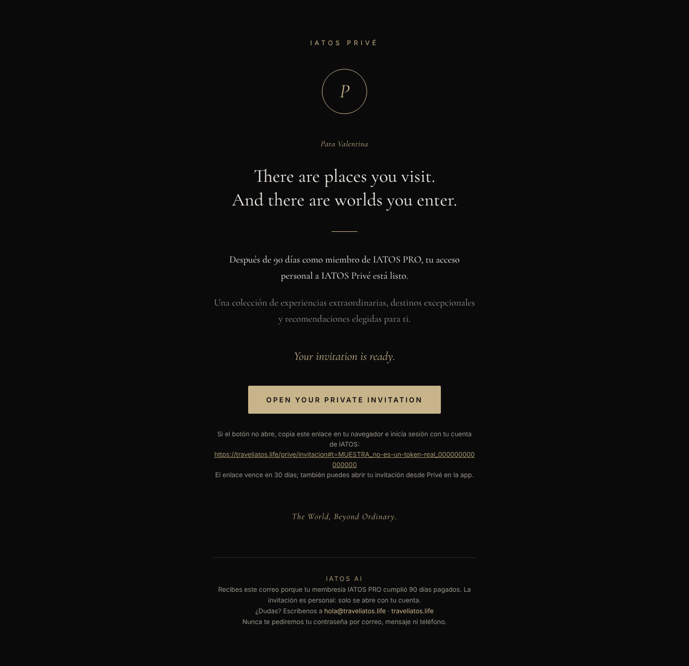
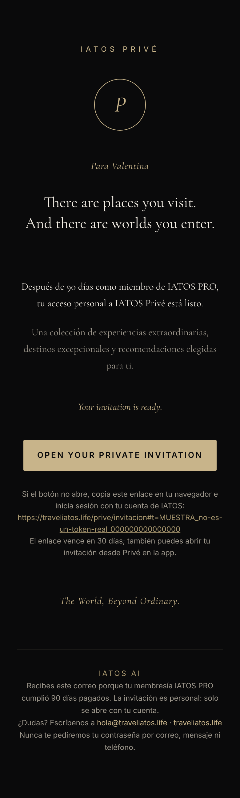
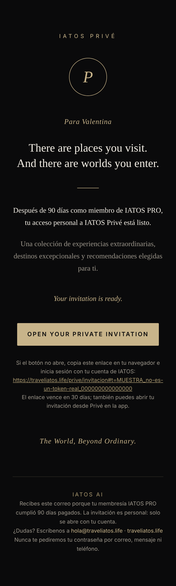
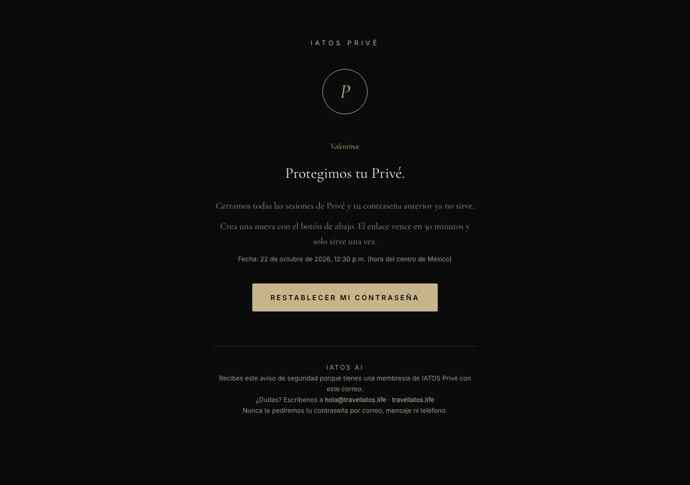

# IATOS Privé · Diseño del correo de invitación y de los avisos

> Parte de la serie Privé. Política: [IATOS_PRIVE_MEMBERSHIP_POLICY.md](IATOS_PRIVE_MEMBERSHIP_POLICY.md) · Invitaciones y seguridad: [IATOS_PRIVE_INVITATIONS.md](IATOS_PRIVE_INVITATIONS.md).
> Código: `supabase/functions/_shared/prive-email.ts` (funciones puras, probadas en `src/test/priveEmail.test.ts`).
> Evidencia: `docs/iatos/evidencia/prive/` (HTML, texto plano y capturas). **Ningún correo real se envió.**

## Resumen para fundadores

- Es una **tarjeta de invitación en negro profundo y dorado champaña**, con un monograma "P" en un anillo dorado, mucho aire y tipografía editorial con serifa.
- Usa **tu texto exacto** (asunto, preencabezado, frases en inglés y en español, botón y cierre).
- Saluda por el **primer nombre** ("Para Valentina").
- **Funciona con imágenes bloqueadas** porque no tiene imágenes: el monograma es texto. Se ve bien en teléfono (390 px) y en escritorio.
- **Nunca lleva contraseña** ni el correo de la persona en el enlace. El enlace solo abre la invitación de **esa** cuenta.
- Hay correos hermanos con el mismo estilo para avisos de seguridad (contraseña creada, cambiada, restablecida, bloqueo, nuevo acceso, sesiones cerradas, "protegimos tu Privé") y para restablecer la contraseña.

---

## 1. Texto (contrato §6, sin cambios)

| Parte | Texto |
|---|---|
| Asunto | A private invitation awaits you. |
| Preencabezado | 90 days. A new world opens. |
| Encabezado | IATOS PRIVÉ |
| Saludo (agregado, personalizado) | Para {Nombre} — se omite si no hay nombre |
| Cuerpo | There are places you visit. / And there are worlds you enter. |
| | Después de 90 días como miembro de IATOS PRO, tu acceso personal a IATOS Privé está listo. |
| | Una colección de experiencias extraordinarias, destinos excepcionales y recomendaciones elegidas para ti. |
| | Your invitation is ready. |
| Botón | OPEN YOUR PRIVATE INVITATION |
| Cierre | The World, Beyond Ordinary. |
| Pie | IATOS AI · por qué lo recibe · ¿Dudas? hola@traveliatos.life · traveliatos.life · "Nunca te pediremos tu contraseña por correo, mensaje ni teléfono." |

- **Concesión de administrador** (no cumplió 90 días pagados): la frase de los 90 días se cambia por "Tu acceso personal a IATOS Privé está listo." y el pie explica que el equipo le concedió el acceso. Así no se afirma algo falso.
- Bajo el botón, en letra pequeña: el enlace en texto (por si el botón no abre), que vence en 30 días y que también puede abrir la invitación desde Privé en la app.

## 2. Diseño

- **Colores:** negro profundo `#0A0A0B`, dorado champaña `#C8B48A` (y `#A8976F` para enlaces secundarios), marfil `#F2EDE4` para el texto principal, gris cálido `#9C968B` para el secundario, línea `#2A2722`.
  Contraste: marfil sobre negro ≈ 17:1; gris sobre negro ≈ 6.9:1; negro sobre el botón dorado ≈ 10:1 (todos superan AA).
- **Tipografía:** serif editorial `Cormorant Garamond` (Google Fonts, opcional) con respaldo `Playfair Display, Didot, Bodoni 72, Georgia, Times New Roman`. Los rótulos y el botón en sans del sistema con espaciado amplio.
- **Monograma:** "P" en cursiva dentro de un anillo dorado de 1 px (celda con `border-radius:50%`). En Outlook de escritorio (que no redondea) se dibuja un óvalo VML con el mismo texto. Es **texto vivo**: se ve con imágenes bloqueadas.
- **Botón a prueba de balas:** celda de tabla con fondo dorado + enlace con relleno; en Outlook, rectángulo VML con el enlace. Es clicable en todos los clientes.
- **Maqueta:** tablas `role="presentation"` de 600 px centradas, estilos en línea, espacios generosos (72 px arriba y abajo, 36–56 px entre bloques). En pantallas ≤ 620 px una regla `@media` reduce márgenes y tamaños.
- **Modo oscuro:** el correo ya es oscuro y lo declara (`<meta name="color-scheme" content="dark">`, `supported-color-schemes`, `:root{color-scheme:dark}`) y usa `bgcolor` además de `background-color`, para que los clientes que invierten colores no lo "aclaren".
- **Preencabezado oculto** con relleno invisible para que la vista previa del buzón no muestre el cuerpo.
- **Sin rastreo:** no hay píxeles ni imágenes remotas; no se registran aperturas (D9).

## 3. Seguridad y privacidad del correo

- El enlace es `https://traveliatos.life/prive/invitacion#t=<token>`: el token va en el **fragmento**, que el navegador no envía a servidores.
- Ningún enlace lleva el correo, nombre ni parámetros `?`. Una prueba revisa todos los `href` (`priveEmail.test.ts`).
- El nombre se escapa (`escapeHtml`); un nombre con `` o comillas no inyecta HTML (probado).
- `SITE_URL` solo acepta `https` (o `http://localhost` para pruebas); cualquier otra cosa vuelve a `https://traveliatos.life`.
- Un token con forma inválida impide armar el correo (no se envía un enlace roto).
- El texto plano trae lo mismo (para clientes sin HTML y filtros de spam).

## 4. Compatibilidad con clientes de correo

| Cliente | Qué esperar | Base |
|---|---|---|
| Apple Mail (iOS/macOS) | Diseño completo, fuente web, anillo redondo | Soporta `<style>`, `@media`, fuentes web |
| Gmail (web y app) | Diseño completo con **Georgia** (Gmail no carga fuentes web), anillo redondo, `@media` en la mayoría de cuentas | Estilos en línea; `<style>` en `<head>` |
| Outlook 365 / Outlook.com | Diseño completo; fuente de respaldo | Estilos en línea |
| Outlook escritorio (Windows, Word) | Óvalo y botón VML; serif Georgia; 600 px fijos | Comentarios condicionales `[if mso]` |
| Con imágenes bloqueadas | **Igual** (no hay imágenes) | Monograma de texto |
| Modo oscuro forzado (Gmail iOS, Outlook) | Puede ajustar ligeramente tonos; ya es oscuro | `color-scheme: dark` + `bgcolor` |

> **No verificado en clientes reales**: las capturas son de Chromium (Playwright). Antes del lanzamiento conviene una prueba en Litmus/Email on Acid o enviando a buzones de prueba con Resend (requiere autorización: es un envío real).

## 5. Evidencia

Generada con `npx tsx` (render de las funciones puras) y Playwright/Chromium. Token de **muestra** (`MUESTRA_no-es-un-token-real_…`), no válido en ningún entorno.

| Muestra | HTML | Texto | Capturas |
|---|---|---|---|
| Invitación (90 días, "Valentina") | `invitacion.html` | `invitacion.txt` | escritorio 1280, móvil 390, móvil 390 y escritorio 1280 **sin recursos externos** |
| Invitación por concesión, sin nombre | `invitacion-concesion-sin-nombre.html` | `.txt` | escritorio, móvil, móvil sin recursos |
| Restablecer contraseña | `restablecer.html` | `.txt` | escritorio, móvil, móvil sin recursos |
| "Protegimos tu Privé" (comprometida + enlace) | `aviso-comprometida.html` | `.txt` | escritorio, móvil, móvil sin recursos |
| Bloqueo total | `aviso-bloqueo-total.html` | `.txt` | escritorio, móvil, móvil sin recursos |
| Contraseña cambiada · Nuevo acceso | `aviso-contrasena-cambiada.html`, `aviso-nuevo-acceso.html` | `.txt` | — |

- "Sin recursos externos" = toda petición fuera del archivo bloqueada (simula imágenes y fuentes bloqueadas): el diseño cae a Georgia y se conserva.
- Medido en las 16 capturas: **sin desplazamiento horizontal** a 390 px y el monograma presente como texto ("P") en todas.

## 6. Avisos de seguridad

| Tipo | Asunto | Cuándo | Botón |
|---|---|---|---|
| `password_set` | Creaste tu contraseña de IATOS Privé | Al crearla | Revisar mi membresía |
| `password_changed` | Tu contraseña de IATOS Privé cambió | Al cambiarla | Revisar mi membresía |
| `password_reset` | Restableciste tu contraseña de IATOS Privé | Al restablecerla | Revisar mi membresía |
| `sessions_revoked` | Cerraste todas tus sesiones de IATOS Privé | "Cerrar todas" | — |
| `new_access` | Nuevo acceso a tu IATOS Privé | Entrar tras ≥ 5 errores | Revisar mi membresía |
| `hard_lock` | Bloqueamos tu contraseña de IATOS Privé | 15 errores | Revisar mi membresía |
| `compromised` | Protegimos tu IATOS Privé: restablece tu contraseña | "Creo que alguien la conoce" | Restablecer (enlace #t=, 30 min) |
| (restablecer) | Restablece tu contraseña de IATOS Privé | La persona lo pide | Restablecer (enlace #t=, 30 min) |

Todos incluyen fecha y hora (centro de México), "si no fuiste tú…" cuando aplica, y el mismo pie. El mismo evento también deja un aviso en la campana de la app (`notify_once`).

## 7. Reutilizado, construido, corregido, pruebas, pendientes, costos, riesgos y autorizaciones

- **Reutilizado:** `escapeHtml` y `sendEmail` de `_shared/email.ts` (se le agregó un campo opcional de texto plano, sin cambiar a quien ya lo usa), remitente `IATOS AI <hola@traveliatos.life>` con su respaldo de dominio no verificado.
- **Construido:** `prive-email.ts` (invitación, avisos, restablecimiento) y `prive-invite-sender.ts` (envío con reintentos y errores sin datos personales).
- **Corregido:** nada previo; el correo genérico `layout()` no se tocó.
- **Pruebas:** `priveEmail.test.ts` 19 OK (texto exacto, enlaces sin datos, escape, 600 px, sin imágenes, VML, pie, avisos) y `priveCron.test.ts` 7 OK (un envío por invitación, reintentos, redacción de errores); 16 capturas medidas.
- **No verificado:** clientes de correo reales y entregabilidad (requiere enviar correos reales).
- **Costos:** Resend cobra por correo enviado según el plan contratado; Privé envía uno por invitado y avisos solo ante eventos de seguridad.
- **Riesgos:** mientras `traveliatos.life` no esté verificado en Resend, Resend solo entrega al dueño de la cuenta (ver LEEME); los invitados no recibirían el correo, aunque sí el aviso en la app.
- **Requiere autorización productiva:** verificar el dominio en Resend, publicar las funciones y, opcionalmente, una prueba con buzones reales.
