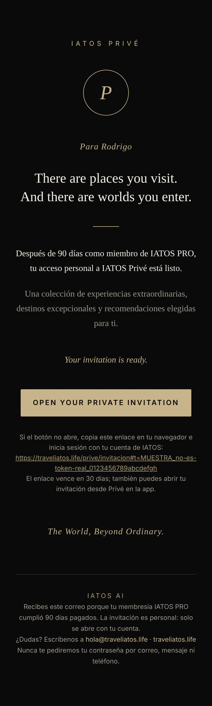
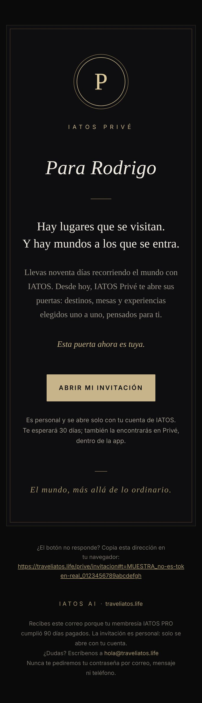
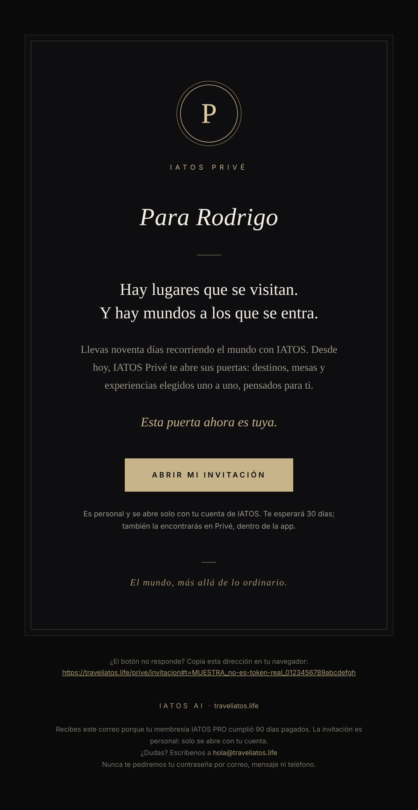
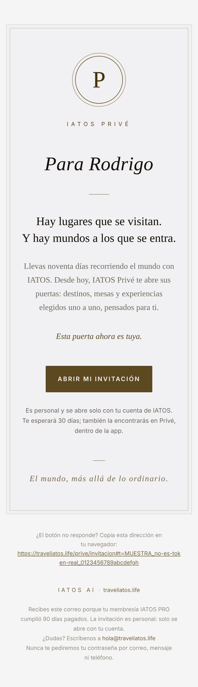

# IATOS Privé · Diseño del correo de invitación y de los avisos

> Parte de la serie Privé. Política: [IATOS_PRIVE_MEMBERSHIP_POLICY.md](IATOS_PRIVE_MEMBERSHIP_POLICY.md) · Invitaciones y seguridad: [IATOS_PRIVE_INVITATIONS.md](IATOS_PRIVE_INVITATIONS.md).
> Código: `supabase/functions/_shared/prive-email.ts` (funciones puras, probadas en `src/test/priveEmail.test.ts`).
> Evidencia: `docs/iatos/evidencia/prive-email/` (rediseño "tarjeta negra", antes/después) y `docs/iatos/evidencia/prive/` (versión anterior y avisos). Entregabilidad: [IATOS_ENTREGABILIDAD_CORREO.md](IATOS_ENTREGABILIDAD_CORREO.md). **Ningún correo real se envió.**

## Resumen para fundadores

- La invitación es ahora una **tarjeta negra entregada en mano**: doble marco fino, un sello con la "P" en doble anillo dorado, la marca IATOS PRIVÉ debajo, y el nombre escrito como en un sobre: ***Para Rodrigo***.
- **Todo en el idioma de la persona**: español por defecto; inglés si su perfil dice inglés (hoy la base no guarda ese dato, así que va en español).
- Una frase ceremonial, sin promoción ni signos de admiración: *Esta puerta ahora es tuya.* Un solo botón: **Abrir mi invitación**.
- **Cero imágenes y cero recursos remotos**: se ve idéntico con imágenes bloqueadas; pesa ~12 KB (Gmail recorta a partir de 102 KB).
- Pensado para no caer en Spam (asunto personal, sin palabras de promoción, sin texto oculto, enlaces solo en `traveliatos.life`, texto plano completo). El resto depende del DNS: ver la guía de entregabilidad.
- Los avisos de seguridad y el restablecimiento usan el mismo marco (sin cambios de texto).

---

## 1. Texto de la invitación

El texto en inglés del §6 original ("A private invitation awaits you.", "OPEN YOUR PRIVATE INVITATION"…) se reemplazó a pedido del dueño (oct. 2026): todo en el idioma de la persona y sin el tono de "invitación misteriosa" que los filtros asocian con fraude. Sus frases en inglés se conservan en la variante en inglés.

| Parte | Español (por defecto) | Inglés (perfil `en`) |
|---|---|---|
| Asunto | {Nombre}, tu invitación a IATOS Privé · sin nombre (o si pasa de 45 caracteres): Tu invitación a IATOS Privé | {Name}, your invitation to IATOS Privé · Your invitation to IATOS Privé |
| Preencabezado | Una invitación personal, a tu nombre. | A personal invitation, in your name. |
| Marca | IATOS PRIVÉ (bajo el sello) | igual |
| Saludo | Para {Nombre} (se omite sin nombre) | For {Name} |
| Título (h1) | Hay lugares que se visitan. / Y hay mundos a los que se entra. | There are places you visit. / And there are worlds you enter. |
| Cuerpo (90 días) | Llevas noventa días recorriendo el mundo con IATOS. Desde hoy, IATOS Privé te abre sus puertas: destinos, mesas y experiencias elegidos uno a uno, pensados para ti. | For ninety days you have travelled the world with IATOS. From today, IATOS Privé opens its doors to you: destinations, tables and experiences chosen one by one, with you in mind. |
| Cuerpo (concesión) | El equipo de IATOS ha guardado tu lugar en IATOS Privé: destinos, mesas y experiencias elegidos uno a uno, pensados para ti. | The IATOS team has kept a place for you in IATOS Privé: … |
| Frase ceremonial | Esta puerta ahora es tuya. | This door is now yours. |
| Botón | Abrir mi invitación | Open my invitation |
| Nota | Es personal y se abre solo con tu cuenta de IATOS. Te esperará 30 días; también la encontrarás en Privé, dentro de la app. | It is personal and opens only with your IATOS account. It will wait for you for 30 days; … |
| Código de miembro | "Miembro · IP-XXXX-XXXX" **solo si se pasa** (hoy no: la app lo revela al aceptar, ver abajo) | "Member" |
| Cierre | El mundo, más allá de lo ordinario. | The World, Beyond Ordinary. |
| Fuera de la tarjeta | ¿El botón no responde? Copia esta dirección en tu navegador: {enlace} | Button not responding? … |
| Pie | IATOS AI · traveliatos.life · por qué lo recibe · contacto · "Nunca te pediremos tu contraseña por correo, mensaje ni teléfono." | en inglés |

- **Contacto del pie:** con el secreto `PRIVE_REPLY_TO` (un buzón que sí recibe) dice "¿Alguna pregunta? Basta con responder a este correo; lo lee una persona del equipo." y el correo lleva Reply-To. Sin él: "¿Dudas? Escríbenos a {SUPPORT_EMAIL}" (hoy `hola@traveliatos.life`, que **no recibe**: acción del dueño en la guía de entregabilidad).
- **Código de miembro:** la plantilla lo sabe pintar (`memberCode`), pero no se le pasa: `prive_claim_invitation_emails` no lo devuelve y la app lo muestra a propósito solo al aceptar (`MemberCard … reveal`). Mostrarlo en el correo arruinaría esa revelación; si el dueño lo quiere, basta con devolverlo en esa función y pasarlo en `prive-invite-sender.ts`.
- **Palabras prohibidas** (prueba automática): exclusivo, VIP, gratis, oferta, urgente, promoción, descuento, premio, "haz clic"… y sus equivalentes en inglés; ningún "!".

## 2. Diseño

- **Composición:** fondo negro `#0A0A0B`; tarjeta `#0E0E10` con borde `#26231E` y un **segundo filete interior** `#3A3226` a 9 px (6 px en móvil), como una tarjeta impresa. Dentro: sello → IATOS PRIVÉ → *Para Rodrigo* → filete → título → cuerpo → frase ceremonial → botón → nota → (código) → filete corto → cierre. El enlace de respaldo y el pie van **fuera** de la tarjeta, para que la tarjeta quede limpia.
- **Sello (monograma):** "P" de texto vivo en serif de alto contraste (`#DCCB9F`, sombra de 1 px que en Apple Mail da un leve relieve de estampado) dentro de **dos anillos**: exterior oro profundo `#7A6A4C`, interior champaña `#C8B48A`. Es HTML/CSS (`border-radius:50%`), `aria-hidden`; en Outlook de escritorio se dibujan dos óvalos VML.
- **Tipografía (sin fuentes web):** títulos y nombre en `Didot, Bodoni 72, Bodoni MT, Playfair Display, Georgia, Times New Roman`; texto en `Baskerville, Palatino Linotype, Palatino, Book Antiqua, Georgia`; rótulos y botón en la sans del sistema con espaciado amplio. En iPhone/Mac se ve en Didot/Baskerville; en Windows en Palatino/Georgia; las capturas (Chromium en Linux) muestran el respaldo Times/Liberation Serif, que es el peor caso.
- **Texto sin viudas:** la última palabra de cada párrafo va unida con espacio duro (no queda "ti." sola en una línea).
- **Botón a prueba de balas:** celda dorada + enlace con relleno; en Outlook, rectángulo VML con el texto en mayúsculas. En el código el texto va en minúsculas ("Abrir mi invitación") y se ve en versalitas por CSS.
- **Colores y contraste:** marfil `#F2EDE4` sobre la tarjeta ≈ 17:1; gris `#9C968B` ≈ 6.9:1; negro sobre el botón dorado ≈ 10:1; el pie `#77726A` ≈ 4.2:1 (texto pequeño secundario).
- **Modo oscuro:** declara `color-scheme: dark` y usa `bgcolor` además de `background-color`. Si un cliente lo invierte (Gmail en iPhone), queda como **papelería marfil con tinta bronce** (ver captura "gmail-oscuro-invertido", simulada con `invert(1) hue-rotate(180deg)`): legible y elegante, sin tonos azules.
- **Accesibilidad:** `lang` según idioma, `<h1>` para el título, `role="article"` con `aria-label`, todas las tablas `role="presentation"`, sello oculto al lector de pantalla, sin imágenes (no hay `alt` que falte).
- **Peso:** ~12–13 KB de HTML (prueba: < 30 KB; Gmail recorta a 102 KB).

### Dirección de arte (rondas)

| Ronda | Qué se vio | Qué se cambió |
|---|---|---|
| 0 (antes) | Mezcla inglés/español, asunto en inglés, botón largo en mayúsculas, enlace de respaldo y pie mezclados con el cuerpo, fuente web remota, relleno invisible | — |
| 1 | Todo en español; tarjeta con borde; doble anillo; nombre grande bajo "Para" | `evidencia/prive-email/ronda1-es--movil-390.jpg` |
| 2 | El nombre de marca encima del sello competía con él; el cuerpo en escritorio era una línea de ~80 caracteres; el enlace de respaldo ensuciaba la tarjeta; entre 621 y 647 px de ancho el margen exterior provocaba desplazamiento horizontal | Sello primero y marca debajo; medida del cuerpo más estrecha (76 px de margen); enlace de respaldo fuera de la tarjeta; margen exterior solo en móvil |
| 3 | Faltaba el gesto de "tarjeta impresa" | Segundo filete interior; márgenes de móvil afinados |
| 4 | Viudas ("ti." sola) y repetición "lugar… lugares… para ti… para ti" en la concesión | Espacio duro en la última palabra; "destinos, mesas y experiencias"; texto de concesión reescrito |
| 5 (final) | Saludo en dos niveles ("Para" pequeño + nombre) | *Para Rodrigo* en una sola línea, cursiva display, como escrito a mano en un sobre |

### Capturas (antes → después)

Sin red (fuentes e imágenes remotas bloqueadas siempre, como en Gmail). "Escritorio" = correo de 600 px en una ventana de 680 px; "móvil" = 390 px; "gmail-oscuro-invertido" = inversión simulada. Medido: sin desplazamiento horizontal en ninguna, incluido un nombre de 40 caracteres.

| Modo | Antes | Después (es) | Después (en) |
|---|---|---|---|
| Escritorio 600 | `antes-es--escritorio-600.jpg` | `despues-es--escritorio-600.jpg` | `despues-en--escritorio-600.jpg` |
| Móvil 390 | `antes-es--movil-390.jpg` | `despues-es--movil-390.jpg` | `despues-en--movil-390.jpg` |
| Imágenes bloqueadas | `antes-es--sin-imagenes-390.jpg` | `despues-es--sin-imagenes-390.jpg` | `despues-en--sin-imagenes-390.jpg` |
| Gmail oscuro (invertido) | `antes-es--gmail-oscuro-invertido-390.jpg` | `despues-es--gmail-oscuro-invertido-390.jpg` | `despues-en--gmail-oscuro-invertido-390.jpg` |

También: `despues-es-concesion-sin-nombre--*` y `despues-es-codigo-respuesta--*` (con código de miembro y Reply-To), y los `.html`/`.txt` de cada variante.

## 3. Seguridad y privacidad del correo

- El enlace es `https://traveliatos.life/prive/invitacion#t=<token>`: el token va en el **fragmento**, que el navegador no envía a servidores.
- Ningún enlace lleva el correo, nombre ni parámetros `?`. Una prueba revisa todos los `href` (`priveEmail.test.ts`).
- El nombre se escapa (`escapeHtml`); un nombre con `` o comillas no inyecta HTML (probado).
- `SITE_URL` solo acepta `https` (o `http://localhost` para pruebas); cualquier otra cosa vuelve a `https://traveliatos.life`.
- Un token con forma inválida impide armar el correo (no se envía un enlace roto).
- El texto plano trae lo mismo (para clientes sin HTML y filtros de spam).
- Encabezados (vía `sendEmail`, campo `headers` de Resend): `X-Entity-Ref-ID: prive-invitacion-<id de invitación>` (nunca el token) y `Reply-To` solo si `PRIVE_REPLY_TO` es un correo válido. `sendEmail` descarta cualquier encabezado con salto de línea o nombre inválido (no se puede inyectar otro encabezado).

## 4. Compatibilidad con clientes de correo

| Cliente | Qué esperar | Base |
|---|---|---|
| Apple Mail (iOS/macOS) | Diseño completo en Didot/Baskerville del sistema, anillos redondos, relieve del sello | Soporta `<style>`, `@media`, `text-shadow` |
| Gmail (web y app) | Diseño completo con las fuentes del dispositivo (Georgia/Times en el peor caso), anillos redondos, `@media` en la mayoría de cuentas | Estilos en línea; `<style>` en `<head>` |
| Outlook 365 / Outlook.com | Diseño completo; fuente de respaldo | Estilos en línea |
| Outlook escritorio (Windows, Word) | Doble óvalo y botón VML; serif Georgia/Palatino; 600 px fijos | Comentarios condicionales `[if mso]` |
| Con imágenes bloqueadas | **Igual** (no hay imágenes) | Monograma de texto |
| Modo oscuro forzado (Gmail iOS, Outlook) | Si invierte, queda marfil con tinta bronce (captura simulada); si no, igual | `color-scheme: dark` + `bgcolor` |

> **No verificado en clientes reales**: las capturas son de Chromium (Playwright). Antes del lanzamiento conviene una prueba en Litmus/Email on Acid o enviando a buzones de prueba con Resend (requiere autorización: es un envío real).

## 5. Evidencia

> La evidencia del rediseño (antes/después) está en §2 y en `docs/iatos/evidencia/prive-email/`. Lo que sigue es la evidencia de la **versión anterior** y de los avisos de seguridad (su texto no cambió; su marco ahora es el de la tarjeta).

Generada con `npx tsx` (render de las funciones puras) y Playwright/Chromium. Token de **muestra** (`MUESTRA_no-es-un-token-real_…`), no válido en ningún entorno.

| Muestra | HTML | Texto | Capturas |
|---|---|---|---|
| Invitación (90 días, "Valentina") | `invitacion.html` | `invitacion.txt` | escritorio 1280, móvil 390, móvil 390 y escritorio 1280 **sin recursos externos** |
| Invitación por concesión, sin nombre | `invitacion-concesion-sin-nombre.html` | `.txt` | escritorio, móvil, móvil sin recursos |
| Restablecer contraseña | `restablecer.html` | `.txt` | escritorio, móvil, móvil sin recursos |
| "Protegimos tu Privé" (comprometida + enlace) | `aviso-comprometida.html` | `.txt` | escritorio, móvil, móvil sin recursos |
| Bloqueo total | `aviso-bloqueo-total.html` | `.txt` | escritorio, móvil, móvil sin recursos |
| Contraseña cambiada · Nuevo acceso | `aviso-contrasena-cambiada.html`, `aviso-nuevo-acceso.html` | `.txt` | — |

- "Sin recursos externos" = toda petición fuera del archivo bloqueada (simula imágenes y fuentes bloqueadas): el diseño cae a Georgia y se conserva.
- Medido en las 16 capturas: **sin desplazamiento horizontal** a 390 px y el monograma presente como texto ("P") en todas.

## 6. Avisos de seguridad

| Tipo | Asunto | Cuándo | Botón |
|---|---|---|---|
| `password_set` | Creaste tu contraseña de IATOS Privé | Al crearla | Revisar mi membresía |
| `password_changed` | Tu contraseña de IATOS Privé cambió | Al cambiarla | Revisar mi membresía |
| `password_reset` | Restableciste tu contraseña de IATOS Privé | Al restablecerla | Revisar mi membresía |
| `sessions_revoked` | Cerraste todas tus sesiones de IATOS Privé | "Cerrar todas" | — |
| `new_access` | Nuevo acceso a tu IATOS Privé | Entrar tras ≥ 5 errores | Revisar mi membresía |
| `hard_lock` | Bloqueamos tu contraseña de IATOS Privé | 15 errores | Revisar mi membresía |
| `compromised` | Protegimos tu IATOS Privé: restablece tu contraseña | "Creo que alguien la conoce" | Restablecer (enlace #t=, 30 min) |
| (restablecer) | Restablece tu contraseña de IATOS Privé | La persona lo pide | Restablecer (enlace #t=, 30 min) |

Todos incluyen fecha y hora (centro de México), "si no fuiste tú…" cuando aplica, y el mismo pie. El mismo evento también deja un aviso en la campana de la app (`notify_once`).

## 7. Reutilizado, construido, corregido, pruebas, pendientes, costos, riesgos y autorizaciones

- **Reutilizado:** `escapeHtml` y `sendEmail` de `_shared/email.ts` (se le agregó un campo opcional de texto plano, sin cambiar a quien ya lo usa), remitente `IATOS AI <hola@traveliatos.life>` con su respaldo de dominio no verificado.
- **Construido:** `prive-email.ts` (invitación, avisos, restablecimiento) y `prive-invite-sender.ts` (envío con reintentos y errores sin datos personales).
- **Corregido (oct. 2026, rediseño):** idioma de la persona, asunto personal, sin relleno invisible ni fuente remota, nuevo marco de tarjeta, `X-Entity-Ref-ID`, Reply-To opcional (`PRIVE_REPLY_TO`), remitente `IATOS Privé <hola@traveliatos.life>` para la invitación, `sendEmail` acepta `headers` (filtrados). El correo genérico `layout()` no se tocó.
- **Pruebas:** `priveEmailDeliverability.test.ts` (tamaño, palabras de promoción, sin relleno ni recursos remotos, enlaces en el dominio, accesibilidad, texto plano, español/inglés, escape, código de miembro, Reply-To, encabezados); `priveEmail.test.ts` 19 OK (texto exacto, enlaces sin datos, escape, 600 px, sin imágenes, VML, pie, avisos) y `priveCron.test.ts` 7 OK (un envío por invitación, reintentos, redacción de errores); 16 capturas medidas.
- **No verificado:** clientes de correo reales y entregabilidad (requiere enviar correos reales).
- **Costos:** Resend cobra por correo enviado según el plan contratado; Privé envía uno por invitado y avisos solo ante eventos de seguridad.
- **Riesgos:** mientras `traveliatos.life` no esté verificado en Resend, Resend solo entrega al dueño de la cuenta (ver LEEME); los invitados no recibirían el correo, aunque sí el aviso en la app.
- **Requiere autorización productiva:** verificar el dominio en Resend, publicar las funciones y, opcionalmente, una prueba con buzones reales.
